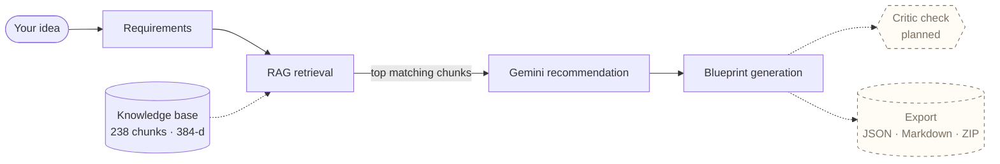

<p align="center">
  
</p>

<h1 align="center">BuildMyML</h1>

<p align="center">
  <b>Turn a plain-language idea into a structured machine learning plan.</b><br>
  Grounded in a curated ML knowledge base, with every recommendation tied to its source.
</p>

<p align="center">
  
  
  
  
  
</p>

---

## What it does

You describe a problem in your own words, such as *"predict customer churn for a telecom company."* BuildMyML:

1. **Extracts the requirements**: the task, the target, and the constraints.
2. **Retrieves guidance** from a curated knowledge base of machine learning practice, using semantic search.
3. **Asks Gemini** to recommend a learning task, preprocessing steps, candidate models, and evaluation metrics, using only the retrieved passages as context.
4. **Assembles a blueprint** you can read, check, and export.

The goal is to help beginners make the design decisions *before* any training code is written: is it classification or clustering, which metric fits an imbalanced dataset, and where data leakage could creep in.

---

## How it works



| Stage | What it does | Status |
|---|---|---|
| Requirements | Structures the idea into task, target, and constraints | Built, end-to-end run not yet verified |
| RAG retrieval | Finds the knowledge-base passages closest in meaning to the idea | Built, end-to-end run not yet verified |
| Gemini recommendation | Writes the recommendations, grounded in the retrieved passages | Built, end-to-end run not yet verified |
| Blueprint generation | Assembles architecture, metrics, and roadmap | Built, end-to-end run not yet verified |
| Critic check | Checks that the model, metric, and preprocessing agree | Planned |
| Export | Downloads the blueprint as JSON, Markdown, or ZIP | In progress |

---

## Knowledge base

| Parameter | Value |
|---|---|
| Source documents | 6 curated ML documents (preprocessing, classification, regression, clustering, evaluation metrics, model selection) |
| Chunking | 400 units per chunk, 50-unit overlap |
| Chunks produced | 238 (no empty chunks) |
| Embedding model | `all-MiniLM-L6-v2` (sentence-transformers) |
| Embedding size | 384 dimensions |
| Storage | Supabase PostgreSQL with pgvector, table `public.document_chunks` |
| Search function | `public.match_document_chunks` |

---

## Quick start

**Requirements:** Python 3.11+, Node.js 18+, a Supabase project, and a Gemini API key.

```bash
# 1. Clone
git clone https://github.com/himaparvathia23ec/BuildMyML.git
cd BuildMyML

# 2. Configure secrets (never commit this file)
cp backend/.env.example backend/.env
# then fill in GEMINI_API_KEY, SUPABASE_URL, SUPABASE_KEY

# 3. Backend
cd backend
python -m venv .venv && source .venv/bin/activate
pip install -r requirements.txt
uvicorn main:app --reload --port 8000

# 4. Frontend (in a second terminal)
cd frontend
npm install
npm run dev        # http://localhost:5173
```

API docs are available at **http://localhost:8000/docs** once the backend is running.

---

## Environment variables

| Variable | Used for |
|---|---|
| `GEMINI_API_KEY` | Gemini recommendation calls |
| `SUPABASE_URL` | Your Supabase project URL |
| `SUPABASE_KEY` | Supabase access for storing and searching chunks |
| `FRONTEND_ORIGIN` | Allowed origin for CORS (default `http://localhost:5173`) |

---

## API

| Method | Route | Purpose |
|---|---|---|
| `POST` | `/blueprints` | Submit an idea and run the pipeline |
| `GET` | `/blueprints/{id}` | Reload a saved run |
| `GET` | `/blueprints/{id}/export?format=json\|md\|zip` | Download the blueprint |

---

## Tech stack

**Backend:** FastAPI, sentence-transformers (`all-MiniLM-L6-v2`), Google Gemini API
**Storage:** Supabase PostgreSQL with pgvector
**Frontend:** React, Vite, Tailwind CSS

---

## Roadmap

- [ ] Verify the full pipeline on real inputs, with stage status shown from actual runs
- [ ] Return datasets only with a verified source URL
- [ ] Implement the Critic check
- [ ] Export JSON, Markdown, and ZIP from saved runs
- [ ] GitHub sign-in
- [ ] Measure retrieval relevance and blueprint quality on a fixed set of project ideas

---

## Security

- Secrets live in `backend/.env`, which is excluded from git.
- If a key was ever committed, rotate it, even after removing it from the latest commit.

---

## Team

Built at the Department of CSE (AI & ML), Sai Vidya Institute of Technology, Bengaluru.

Dr Kumaresh Sheelavant · Aayush N · B Rishitha · Harshita R · Hima Parvathi A
