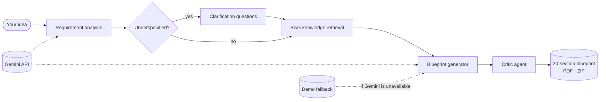

<h1 align="center">BuildMyML</h1>

<p align="center">
  <b>Describe a machine learning idea in plain language. Get a complete 20-section architecture blueprint.</b><br>
  Datasets, preprocessing, algorithms, validation, deployment, monitoring, and a roadmap, ready to download.
</p>

<p align="center">
  <a href="https://build-my-ml.onrender.com"></a>
  
  
  
  
</p>

---
## Institution Details

This project is developed as part of the Major Project for the academic year 2026–2027.

### Institution Details

**Institution:** Sai Vidya Institute of Technology  
**Affiliated University:** Visvesvaraya Technological University (VTU)  
**Department:** Computer Science and Engineering (Artificial Intelligence and Machine Learning)  
**Location:** Bengaluru, Karnataka, India

### Project Team

**Team Number:** 25  
**Project Title:** Build-My-ML — An Intelligent and Explainable Project Design System

### Academic Details

**Programme:** Bachelor of Technology / Bachelor of Engineering (B.E.)  
**Academic Year:** 2026–2027

---

## Why it exists

Most AutoML tools start after the problem is already defined. BuildMyML works earlier, at the point where a beginner asks *"what should I even build?"* It turns a rough idea into a structured plan: what the target is, which metric fits, where leakage could creep in, and how the project should be validated and deployed.

It does **not** train a model. It designs the project around one.

---

## Try it

**Live:** https://build-my-ml.onrender.com

1. Type a prompt, or pick a quick or detailed example.
2. Optionally attach a curated public dataset.
3. Answer any clarifying questions, or skip them and use defaults.
4. Read the 20-section blueprint, inspect the architecture diagram, and download the **PDF** or **ZIP**.

Signed-in users can also save projects to their history.

> **Free hosting note:** the Render free tier sleeps when idle. The first request after a pause can take longer.

---

## How it works



| Stage | What happens |
|---|---|
| **Requirement agent** | Turns the prompt and dataset metadata into structured requirements: task, modality, objective, deployment, latency, scale, and constraints. |
| **Clarification agent** | Runs only when the prompt is underspecified. Asks two to four multiple-choice questions. |
| **RAG retrieval** | Ranks the local ML knowledge base by modality, tags, keywords, and dataset-specific boosters, and keeps the top five references. |
| **Blueprint generator** | Builds the full 20-section plan from requirements, answers, dataset metadata, and references. |
| **Critic agent** | Audits leakage, validation protocol, metrics, and diagram edges, then patches what it can. |
| **Demo fallback** | Produces a complete deterministic blueprint when Gemini is missing or unavailable. Marked `demoFallback: true`. |

---

## What you get

- **20 architecture sections:** problem definition, objectives, ML task, dataset strategy, data collection, preprocessing, EDA, feature engineering and selection, algorithms, model justification, training pipeline, evaluation, validation, architecture, technology stack, deployment, monitoring, and roadmap.
- **Interactive architecture diagram:** five colored lanes, clickable nodes, edge labels, forward and feedback connections, and SVG export.
- **Curated datasets:** 15 public datasets with source URLs, licenses, schemas, and live previews where available. Telecom churn, breast cancer, Cleveland heart disease, California housing, German credit, Spambase, Pima diabetes, Palmer penguins, MNIST, and more.
- **Exports:** a formatted **PDF**, and a **ZIP** containing the PDF, dataset attribution, an architecture spec, the SVG diagram, the JSON blueprint, RAG and critic reports, a CSV template, a Python skeleton, and a Markdown README.
- **Saved projects:** sign in with Google to keep your history, reopen projects, and delete them. Each user only sees their own projects.

---

## Quick start

**Requirements:** Node.js 18+ and npm.

```bash
# 1. Clone
git clone https://github.com/himaparvathia23ec/BUILD-MY-ML.git
cd BUILD-MY-ML

# 2. Install
npm install

# 3. Configure (optional, but enables live Gemini output)
cp .env.example .env
# set GEMINI_API_KEY in .env

# 4. Run in development (Express + Vite together)
npm run dev
```

Open **http://localhost:3000**.

Without a Gemini key, the app still works: blueprints come from the deterministic demo fallback.

### Scripts

| Command | What it does |
|---|---|
| `npm run dev` | Starts the Express server with Vite middleware |
| `npm run build` | Builds the frontend into `dist/` |
| `npm start` | Runs production mode (`tsx server.ts`), serving `dist/` and `/api/*` |
| `npm run lint` | Type-checks with `tsc --noEmit` |
| `npm run preview` | Previews the built frontend |

---

## Configuration

| Variable | Required | Purpose |
|---|---|---|
| `GEMINI_API_KEY` | No | Enables live Gemini agents. Server-side only. |
| `NODE_ENV` | No | Set to `production` on Render, so the server serves `dist/`. |
| `PORT` | No | Supplied by Render. Defaults to `3000`. |
| `APP_URL` | No | Documented in `.env.example`. Not used by core generation. |

Firebase's public web configuration lives in `firebase-applet-config.json`. Those values are client configuration, not secrets.

---

## API

| Method | Route | Purpose |
|---|---|---|
| `GET` | `/api/health` | Health check |
| `GET` | `/api/datasets` | List datasets (`?q=` search, `?category=` filter) |
| `GET` | `/api/datasets/:id/preview` | Sample rows, or a verified schema for large files |
| `GET` | `/api/datasets/:id/download` | Dataset download |
| `POST` | `/api/blueprint/analyze` | Requirement analysis and clarification questions |
| `POST` | `/api/blueprint/generate?stream=true` | Streams stage events, then the final blueprint |

---

## Tech stack

| Layer | Tools |
|---|---|
| Frontend | React 19, TypeScript, Vite, Tailwind CSS |
| Backend | Express, `tsx`, the Gemini SDK |
| Persistence | Firebase Authentication (Google) and Firestore |
| Exports | jsPDF (PDF), JSZip (ZIP) |
| Hosting | Render (Node web service) |

---

## Project structure

```
server.ts                       Express app, routes, SSE generation, demo fallback
server/
  agents/                       requirement, clarification, RAG, blueprint, critic, Gemini client
  datasets.ts                   curated dataset catalogue and helpers
  knowledge/mlKnowledgeBase.ts  local ML knowledge documents
src/
  App.tsx                       main controller
  components/                   prompt workspace, dataset explorer, blueprint view, architecture diagram
  utils/                        diagram renderer, PDF generator, ZIP exporter
  services/projectRepository.ts Firestore persistence, owner-isolated
  types/ml.ts                   shared data model (frontend and backend contract)
firestore.rules                 owner-based security rules
```

---

## Honest notes

- **Demo output is deterministic.** When Gemini isn't available, the blueprint is built from domain keyword detection, dataset metadata, RAG ranking, and fixed architecture patterns. It's a structured demonstration, not a live AI response. The app labels it as demo output.
- **No model training.** BuildMyML designs the project. It doesn't train candidate algorithms.
- **Retrieval is lexical.** The RAG step ranks the local knowledge base by terms and tags. It doesn't use embeddings or an external vector database.
- **No automated tests yet.** Validation so far is `npm run lint`, `npm run build`, and manual checks of the API routes.

---

## Roadmap

- [ ] Replace lexical RAG with embedding-based retrieval
- [ ] Add automated tests for the agents and API routes
- [ ] Add the Vite native config-loader warning fix and split the large bundle
- [ ] Rewrite this README against any future architecture changes

---

## Security

- Keep `GEMINI_API_KEY` in `.env` on the server. Never put it in the browser code, the Firebase config, or Git.
- Any key that has been committed or pasted anywhere should be revoked and replaced.
- Firestore rules require verified users, owner checks, constrained field lengths, and server timestamps.

---

## Team & College

Built at the Department of CSE (AI & ML), Sai Vidya Institute of Technology, Bengaluru.

Dr Kumaresh Sheelavant · Aayush N · B Rishitha · Harshita R · Hima Parvathi A

Sai Vidya Institute of Technology 
this college is an engineering institution located in Bengaluru, Karnataka, India.
This project, BuildMyML, is developed as part of the academic curriculum by students of the Department of Computer Science and Engineering (Artificial Intelligence and Machine Learning).

---

## License

To be added by the team.
